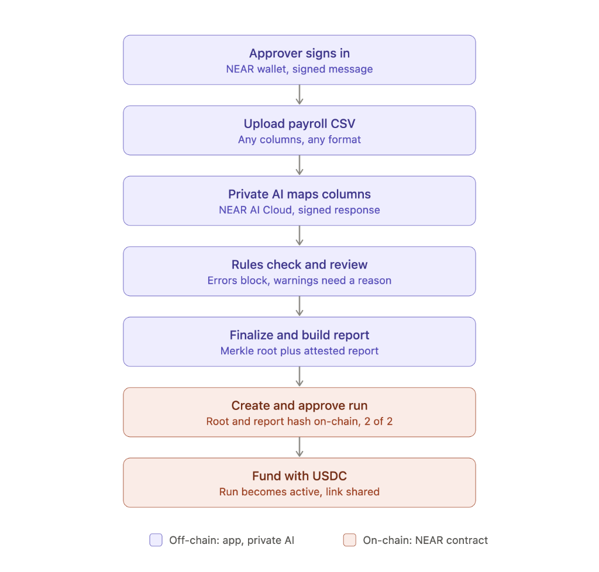
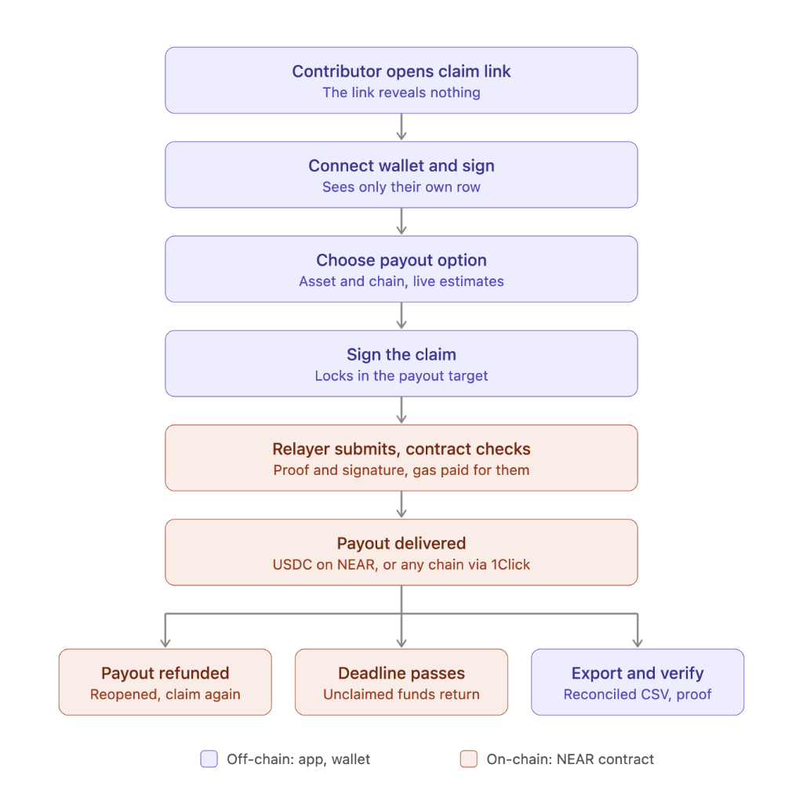

# Blindroll

**Claim-based USDC payroll on NEAR: no public salary table, and each contributor sees and claims only their own row.** Built for the NEAR Hackathon (Real-World Money + Privacy & Private AI).

**What makes it different**

1. **Messy CSV in.** Any column names, any number format, straight from the HR or accounting export.
2. **Private AI mapping.** NEAR AI Cloud (a TEE-hosted model) proposes which column is which; the response is **signed**, and the signature is checked. The AI proposes, code decides: it never touches amounts or payment decisions.
3. **Deterministic rules.** Code normalizes amounts to integer base units and runs the checks (bad addresses, duplicates, outliers, budget). Errors block; warnings need a written reason.
4. **Attested report hash locked on-chain.** The report (hashes and counts only, no names or amounts per person) and the Merkle root of the table go into the contract with `create_run`. Anyone can recompute and compare them on the verify page.
5. **Claim-based self-verification.** No public salary table: each recipient connects a wallet, signs a message, sees only their own row and claims it with a Merkle proof.
6. **Gas-free claims via a relayer.** EVM recipients sign a message; NEAR recipients press one button. The relayer pays the gas and cannot redirect the payout.

## How a company uses this

- A remote team or a group of contractors is paid once a month.
- Finance exports the run from their HR or accounting tool and uploads the CSV; the AI maps the columns and the rules flag problems before anyone signs.
- Two approvers review and approve the run from their NEAR wallets, then the team funds it with USDC.
- Each contractor opens the claim link, connects a wallet and gets paid in USDC on NEAR (other chains through NEAR Intents 1Click on mainnet; simulated on testnet).
- Finance downloads the reconciled export (claimed, unclaimed, refunded, with transaction hashes); unclaimed funds go back to the treasury after the deadline.

---

## How it works

### Approver flow



| Step | What happens |
|---|---|
| Sign in | NEAR wallet (Meteor or Intear), signed message, not a transaction |
| Upload CSV | Any column names, any format, up to 500 rows |
| Private AI maps columns | NEAR AI Cloud (TEE-hosted model) returns a signed, schema-validated mapping; only the header and 5 sample rows (emails masked) are sent |
| Rules check and review | Errors block finalize; warnings need a written reason |
| Finalize | Merkle root + attested report hash locked — table is immutable |
| Create & approve on-chain | `create_run` + `approve_run` (M-of-N) from browser wallets |
| Fund with USDC | `ft_transfer_call` activates the run; claim link is shared |

### Recipient flow



| Step | What happens |
|---|---|
| Open claim link | The link reveals nothing without a valid signature |
| Connect wallet & sign | Sees only their own row and Merkle proof |
| Choose payout | USDC on NEAR (real, pre-selected), or other chains via NEAR Intents 1Click (live mainnet estimates; delivery simulated on testnet) |
| Sign the claim | Locks in the destination; relayer submits on-chain, pays gas |
| Payout delivered | USDC on NEAR (real), or via 1Click cross-chain (simulated on testnet) |
| If delivery fails | Refund returns to contract → approver reopens → recipient claims again |
| Deadline passes | Unclaimed funds returned to treasury via `reclaim_unclaimed` |
| Verify & export | Report hash, Merkle root, AI signature and each attestation check, shown one by one in the browser; CSV/JSON download |

---

## Privacy model

**First, the trust assumption: the Blindroll server can read the full payroll table.** It parses the CSV, stores the table encrypted at rest (AES-256-GCM), and shows a recipient only their own row after a valid wallet signature. On-chain, only the Merkle root and the report hash are public; a claim reveals that one recipient's address and amount. Future work: run the backend in a TEE. The claim page and the run page show this notice.

| | Who can see it |
|---|---|
| Full payroll table | **The Blindroll server and the approvers.** Never published |
| Names, emails, roles, memos | The server and the approvers; off-chain only |
| A recipient's own row | That recipient, after a wallet signature |
| AI prompt (header + 5 sample rows, emails masked) and response | NEAR AI Cloud's model TEE; only their hashes and the response signature are in the report |
| Run metadata (approvers, deadline, total, Merkle root, report hash) | **Public** (contract state) |
| A claimed row's address and amount | **Public, once claimed** (claim transaction) |

After everyone claims, an observer can reconstruct most amounts and addresses from the chain. What stays off the public chain: identities, memos, and rows not yet claimed. Why rows are not encrypted to each recipient's wallet, and what would change that: [docs/08](docs/08-privacy-model.md#why-not-client-side-decryption-yet).

---|---|
| Full payroll table, unclaimed rows | **No** — never published |
| Names, emails, roles, memos | **No** — off-chain only |
| AI prompts and responses | **No** — only their hashes and the response signature are in the report |
| Run metadata (approvers, deadline, total, Merkle root, report hash) | **Yes** |
| A claimed row's address and amount | **Yes, once claimed** |

The backend stores the table encrypted at rest (AES-256-GCM) and serves each recipient only their own row after a valid wallet signature. After everyone claims, an observer can reconstruct amounts and addresses from the chain — what stays hidden is everything unclaimed: identities, memos, and rows not yet claimed.

---

## Testnet deployment

| | |
|---|---|
| Contract | [`blindroll.blindroll-dev.testnet`](https://testnet.nearblocks.io/address/blindroll.blindroll-dev.testnet) |
| Test token (mUSDC) | [`usdc.blindroll-dev.testnet`](https://testnet.nearblocks.io/address/usdc.blindroll-dev.testnet) |
| Relayer | [`relayer.blindroll-dev.testnet`](https://testnet.nearblocks.io/address/relayer.blindroll-dev.testnet) |
| Example `create_run` | [transaction on NEARBlocks](https://testnet.nearblocks.io/txns/4Got5u17zqcup7Fk6NDGMtX5TrZbdD5cMU4Xcrqfgixu) |
| Example gas-free claim | [transaction on NEARBlocks](https://testnet.nearblocks.io/txns/7cLq3BTUQA3jpPXbYQUQwReqgyvw3coxjjHFow6VPr4w) |

---

## Supported wallets

| Wallet | Used for | Status |
|---|---|---|
| Meteor (NEAR) | Approvers and NEAR recipients | **Tested** on testnet |
| Intear (NEAR) | Approvers and NEAR recipients | **Tested** on testnet (web wallet; if the browser blocks the signing popup, the page asks for one more click) |
| Sender, Nightly, MyNearWallet (NEAR) | — | **Removed** after browser tests: Sender's import failed on Sender's side; Nightly connects the implicit account, not the named one; MyNearWallet did not work reliably in the owner's test |
| MetaMask or any EIP-6963 browser wallet (EVM) | EVM recipients (view + claim signature) | **Tested** with MetaMask |

Left out, with reasons (no testnet, no message signing, or a relay service that would receive our requests): HOT, HERE, OKX, Bitget, Ledger, WalletConnect, NEAR Mobile ([docs/07](docs/07-wallet-verification-and-claims.md#near-wallets-2026-11-12)). Wallet Selector is deprecated upstream; migration to NEAR Connect is planned.

---

## Real vs simulated

| Part | Status |
|---|---|
| NEAR contract: Merkle proofs, EVM signature recovery, approvals, payouts, reopen, reclaim | **Real** (testnet) |
| Approver flow: sign in, create, approve, fund, cancel, reclaim | **Real** testnet transactions from the browser wallet |
| AI column mapping | **Real** NEAR AI Cloud call (one per new CSV, cached by its hash) |
| USDC claims via relayer (EVM message signature; NEAR gas-free button) | **Real** testnet transactions |
| USDC | **Mock** (`mUSDC`, open mint, no value; mainnet uses native USDC) |
| Cross-chain payout estimates | **Real** 1Click dry quotes (mainnet prices; labelled "Estimated from live mainnet quote") |
| Cross-chain delivery on testnet | **Simulated**: 1Click has no testnet. The contract really pays the test USDC to a holding account; nothing arrives on the destination chain |
| Failed delivery → refund → reopen | Failure **simulated** by an approver button; the refund transfer and `reopen_claim` are **real** transactions |
| AI check a: response signature | **Verified** (EIP-191 signer = signing address), at finalize and in the browser |
| AI check b: attestation document matches the report hash | **Verified** in the browser |
| AI check c: signer is the attested model key | **Verified** in the browser |
| AI check d: TDX quote binds the signer and our nonce | **Verified** in the browser (consistency only until check g) |
| AI check e: event log replays to RTMR3 | **Verified** in the browser (consistency only until check g) |
| AI check f: MRCONFIGID matches the compose hash | **Verified** in the browser (consistency only until check g) |
| AI check g: Intel TDX quote signature (DCAP) | **Not verified** (no DCAP verifier in this version); report says `ai.attestation.verified: false` |
| AI check h: NVIDIA GPU evidence | **Not verified** (out of scope) |
| Confidential payout rail (Confidential Intents) | **Not built** (roadmap; see Future work) |

Details of every attestation check: [docs/05](docs/05-ai-pipeline-and-attestation.md#attestation-checks-2026-11-12).

---|---|
| NEAR contract — Merkle proofs, EVM signature recovery, approvals, payouts, reopen | **Real** (testnet) |
| Approver flow — sign in, create, approve, fund | **Real** testnet transactions |
| AI column mapping | **Real** NEAR AI Cloud call; response signature verified at finalize and on the verify page |
| USDC claims via relayer (EVM + NEAR wallets) | **Real** testnet transactions |
| USDC | **Mock** (`mUSDC`, open mint, no value; mainnet uses native USDC) |
| Cross-chain payout estimates | **Real** 1Click dry quotes (mainnet prices, labelled "estimated") |
| Cross-chain delivery on testnet | **Simulated** — 1Click has no testnet; funds go to a holding account, nothing arrives on the destination chain |
| Failed delivery → refund → reopen | Failure **simulated** by approver button; refund and `reopen_claim` are **real** on-chain transactions |
| TEE attestation | Stored, **not verified** (Intel TDX quote verification not implemented; report says `verified: false`) |

---

## Run locally

**Requirements:** Node 24+, pnpm 9+. Contracts: Rust 1.95+, `wasm32-unknown-unknown` target, [`cargo-near`](https://github.com/near/cargo-near) 0.23+.

```sh
pnpm install
cp .env.example .env.local   # fill in values — never commit
pnpm env:check               # lists any missing variable names
pnpm --filter web dev        # http://localhost:3000
```

**Tests:**

```sh
pnpm -r test                 # vitest (packages/core + apps/web)
pnpm -r typecheck
cd contracts && cargo test   # Rust unit tests + sandbox integration test
```

Use [`docs/samples/payroll-messy.csv`](docs/samples/payroll-messy.csv) as the sample upload. Set `NEAR_AI_LIVE=1` to make a real AI call (cached by CSV hash after the first).

---

## Repo structure

```
apps/web/          Next.js 16 app — approver UI, claim UI, API routes
packages/core/     Merkle tree, claim messages, CSV rules, AI client (TypeScript)
contracts/
  blindroll/       NEAR smart contract (Rust)
  mock-usdc/       Testnet-only USDC token (Rust)
docs/              Full specs (product, architecture, contract, AI, privacy, API…)
```

---

## Known limitations

- **The backend sees the plaintext table** (encrypted at rest). See the privacy model above.
- **TEE attestation only partly verified.** The response signature and five offline consistency checks pass; the Intel TDX quote signature (DCAP) and the NVIDIA GPU evidence are not verified, so the report says `verified: false`.
- **Refunds not proven on-chain.** `reopen_claim` is offered only after the refund transfer succeeds, but the contract itself does not verify the amount came back.
- **Gas-free NEAR claims pay your own account only.** A different NEAR destination requires sending `claim_near` from your own wallet.
- **Two NEAR wallets.** Meteor and Intear are tested; Sender, Nightly and MyNearWallet were removed after browser tests (see Supported wallets).
- **Cross-chain delivery not real on testnet.** The mainnet 1Click execution path is not built.
- **No org management UI.** Approvers are set via environment config.

## Future work

- **Run the backend in a TEE** (NEAR AI Cloud or a Phala-style confidential VM) and publish its attestation, so the plaintext table is only seen by attested code.
- **Full attestation verification:** an offline Intel DCAP verifier (e.g. `dcap-qvl`) with Intel collateral, a pinned measurement allowlist, and NVIDIA GPU evidence.
- **Confidential payout rail.** Today a claim transaction reveals that one recipient's amount and destination. Settling the payout through NEAR Intents' confidential mode (`CONFIDENTIAL_INTENTS` in the 1Click API) would reduce what a claim reveals; shield/unshield and timing stay public. Needs access from the NEAR Intents team, mainnet testing (no testnet), and a contract hook that pays into the intents contract instead of `ft_transfer`. Details: [docs/06](docs/06-payout-rails.md#roadmap-confidential-payout-rail).
- **Mainnet 1Click execution** (non-dry quote, deposit submit, status polling, refunds from 1Click).
- **Prove refunds in `reopen_claim`** (balance vs liabilities check).

---

## License

MIT — see [LICENSE](LICENSE).
